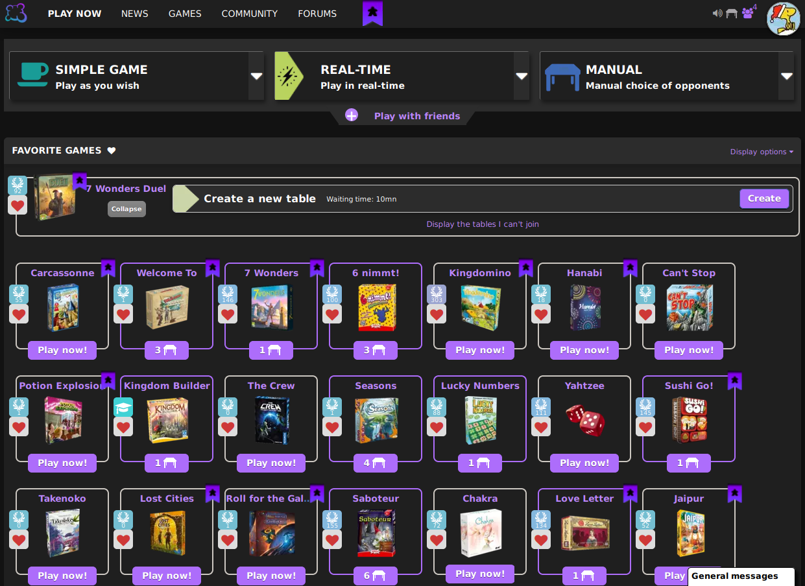
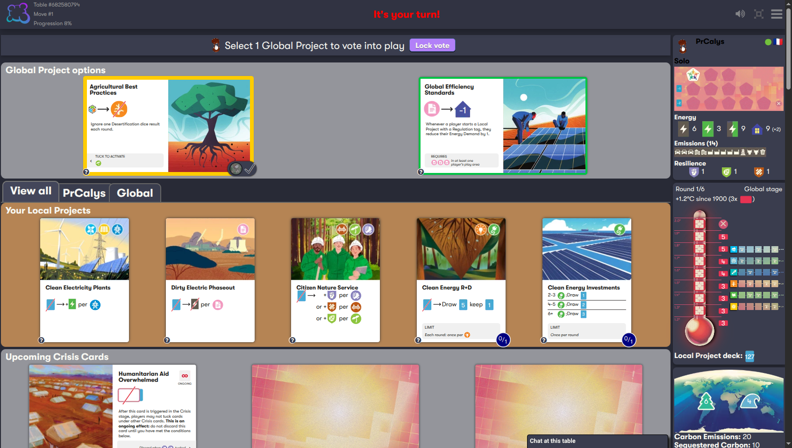

> [!IMPORTANT]
> ## 🧛 This project has moved: [bga-dracula-theme](https://github.com/audabas/bga-dracula-theme)
>
> Its successor, **[audabas/bga-dracula-theme](https://github.com/audabas/bga-dracula-theme)**, builds on
> Board Game Arena's [official dark theme](https://boardgamearena.com/forum/viewtopic.php?p=259278#p259278):
>
> - it brings the **Dracula** color palette to BGA;
> - it **fixes the games that don't render well** with the official dark mode.
>
> 👉 **Head over to [bga-dracula-theme](https://github.com/audabas/bga-dracula-theme)** for installation instructions,
> bug reports and new fixes.

> [!WARNING]
> **This repository is archived and will not receive any further changes.** It is kept for reference only.
> Thank you to everyone who used and contributed to it over the years. 🖤

A dark css theme for [boardgamearena.com](https://boardgamearena.com/)

## Screenshots :

### Homepage

### Game selection

### In-game

